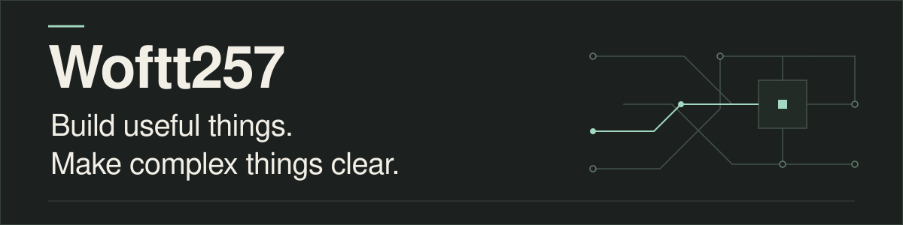

Full-stack development with a focus on Web3: web applications, blockchain gameplay, and payment systems.

[Get in touch](mailto:h.hoangtuan257@gmail.com)

## Selected projects

### [MinePath RPG](https://github.com/TTMordred/MinePath_RPG)

Minecraft/Solana gameplay with connected wallets and NFT/token mechanics.

### [CryptoPath](https://github.com/TTMordred/CryptoPath)

A blockchain explorer with transaction visualization and portfolio tracking.

### [Sui Payment](https://github.com/PayTaskdz/Sui-Payment)

A NestJS backend for crypto-to-fiat payments with wallet and zkLogin authentication.

### [PayTask](https://github.com/TTMordred/paytask)

A Solana microtask marketplace MVP with stablecoin payments.

**Project ecosystem:** TypeScript · React · Next.js · Node.js · NestJS · PostgreSQL · Solana · Sui.

---

For full-stack and Web3 collaboration: [h.hoangtuan257@gmail.com](mailto:h.hoangtuan257@gmail.com).
